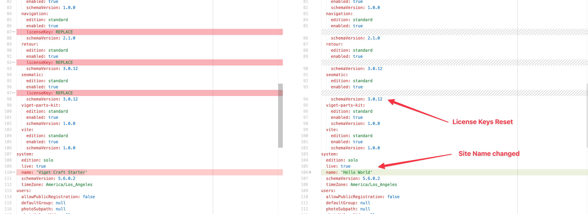
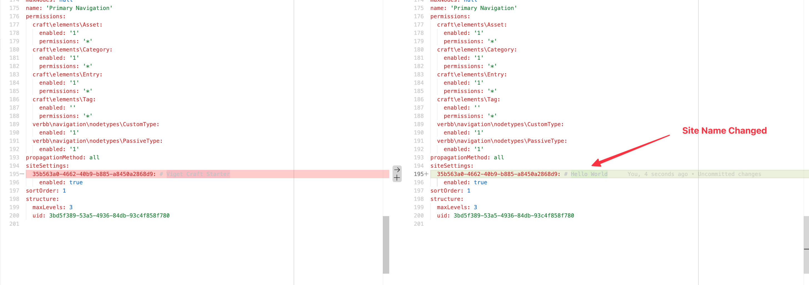

# Viget's Craft CMS Starter

Our Craft Site Starter is a quick way to spin up a new Craft CMS project. It's pre-configured with top-notch build tooling, common plugins and starter components based on [Blueprint](https://github.com/vigetlabs/blueprint).

If you're a designer or developer at Viget working on a new project, view our [Building with Craft Site Starter](docs/building-with-site-starter.md) guide for more information.

# Features

- Local development [powered by DDEV](https://ddev.com/)
- [Claude Code cloud sessions](docs/claude-cloud.md) run the project in DDEV too, with Craft installed
- [Vite](https://vitejs.dev/) based front-end build tooling.
- Automatic linting, formatting and typechecking
  - Runs on git pre-commit hook with [Husky](https://typicode.github.io/husky/)
  - Only processes staged files using [lint-staged](https://github.com/lint-staged/lint-staged)
  - [Prettier](https://prettier.io/), [eslint](https://eslint.org/), [PHPStan](https://github.com/craftcms/phpstan), [PHP
    Easy Coding Standard](https://github.com/craftcms/ecs)
- Common plugins come pre-installed
- Local email is routed
  through [Mailpit](https://ddev.readthedocs.io/en/stable/users/usage/developer-tools/#email-capture-and-review-mailpit) (
  never worry about emailing a client or user)
- [htop](https://htop.dev/) is installed in the DDEV web container for [debugging CPU and memory usage](#debugging-cpu-performance-with-htop-and-xhprof)
- Starter components based on [Blueprint](https://github.com/vigetlabs/blueprint)
- A fully accessible header and navigation
- A simple Matrix Field based block editor
- [Static message translations](https://craftcms.com/docs/5.x/system/sites.html#static-message-translations) have been pre-filled for common elements.
- Error templates: a `_404.twig` page using the site layout, plus `_error.twig` and `_offline.twig` (503/maintenance) pages on a self-contained layout that needs no database or built assets.

## Icons

Icons are bundled into a single SVG spritemap at build time by [@spiriit/vite-plugin-svg-spritemap](https://github.com/SpiriitLabs/vite-plugin-svg-spritemap) and referenced via `<use href>` from the `Icon` macro in `templates/_components/icon.twig`.

To add an icon, drop an SVG into `src/icons/` and run `npm run build`

# Getting Started

## Create Project

1. [Install DDEV](https://ddev.readthedocs.io/en/stable/users/install/ddev-installation/)
2. Choose a folder for your project and move into it:
   ```shell
   cd /path/to/web/projects
   mkdir my-project
   cd my-project
   ```
3. Create The Project
   If you already have PHP and Composer running on your host machine (your computer, not Docker container or DDEV
   instance), you can run the following command

   ```shell
   composer create-project viget/craft-site-starter=^5.0.0 ./ --ignore-platform-reqs
   ```

   If you'd rather not set up PHP, you can create the project with a disposable Docker
   image ([Thanks nystudio107](https://nystudio107.com/blog/dock-life-using-docker-for-all-the-things)).

   ```shell
   docker run --rm -it -v "$PWD":/app -v ${COMPOSER_HOME:-$HOME/.composer}:/tmp composer create-project viget/craft-site-starter=^5.0.0 ./ --ignore-platform-reqs
   ```

4. Start DDEV & Install Craft
   ```shell
   ddev start
   ddev craft install
   ```
5. Run `ddev launch` to open the project in your browser

# Debugging CPU Performance with htop and xhprof

[htop](https://htop.dev/) is installed in the DDEV web container (see `webimage_extra_packages` in `.ddev/config.yaml`). It's an interactive process viewer that shows what is using CPU and memory inside the container: PHP-FPM workers, Craft console commands, Nginx and the Vite dev server.

```shell
ddev exec htop
```

Press `q` or `F10` to quit. htop only sees processes in the web container, not your computer or the database container.

Once htop shows that PHP is the problem, DDEV's built-in [xhprof](https://docs.ddev.com/en/stable/users/debugging-profiling/xhprof-profiling/) profiler shows which PHP functions are using the time (step 5 below).

<details>
<summary>Common workflow: tracking down high CPU usage</summary>

1. **Find the busy container.** On your computer, run `docker stats` to see CPU per container.
   - `ddev-<project>-web` runs PHP, Nginx and Vite. Continue to step 2.
   - `ddev-<project>-db` runs MySQL. See what queries are running with `ddev mysql -e "SHOW FULL PROCESSLIST"`.
   - If neither is busy, the problem is on your computer (Mutagen sync, Docker itself, your editor), not in the project.

2. **Open htop sorted by CPU, in tree view**, so each process sits under the one that started it:

   ```shell
   ddev exec htop --sort-key=PERCENT_CPU --tree
   ```

   | Key  | Action                                               |
   | ---- | ---------------------------------------------------- |
   | `P`  | Sort by CPU                                          |
   | `M`  | Sort by memory                                       |
   | `F5` | Toggle tree view                                     |
   | `F4` | Filter by command, e.g. `php-fpm` or `vite`          |
   | `F9` | Kill the selected process (`SIGTERM` is the default) |

   You can also start htop already filtered: `ddev exec htop --filter=php-fpm`.

3. **Reproduce the problem while htop is open.** Reload the slow page, run the slow `ddev craft` command or save the entry, and watch the `CPU%` column. A process that sits at or near 100% is your culprit. Short spikes are normal.

4. **Match the process to a likely cause.**

   | Process at the top                           | Usually means                                                                                                                                                                                | Next step                                                                                        |
   | -------------------------------------------- | -------------------------------------------------------------------------------------------------------------------------------------------------------------------------------------------- | ------------------------------------------------------------------------------------------------ |
   | `php-fpm: pool www`                          | A slow web request: a heavy Twig template, N+1 element queries, or image transforms being generated. Queue jobs also run here, because Craft runs the queue through web requests by default. | Profile the request (step 5). Check **Utilities → Queue Manager** in the control panel for jobs. |
   | `php ./craft …`                              | A long-running console command, such as `resave/entries` or `clear-caches/all`.                                                                                                              | Let it finish, or kill it with `F9`.                                                             |
   | `node …/vite` or `esbuild`                   | The Vite dev server (a `web_extra_daemons` entry) rebuilding after a file change.                                                                                                            | If it stays high with nothing changing, run `ddev restart`.                                      |
   | `npm install`, `npm run build` or `composer` | Dependencies installing from the `post-start` hook or the Vite daemon, usually right after `ddev start`.                                                                                     | Wait for it to finish.                                                                           |

5. **Profile slow PHP requests.** Once htop points at `php-fpm`, find out which code is slow with DDEV's built-in [xhprof](https://docs.ddev.com/en/stable/users/debugging-profiling/xhprof-profiling/) profiler:

   ```shell
   ddev xhprof on
   ```

   Reload the slow page a few times, then open the results:

   ```shell
   ddev xhgui
   ```

   Turn the profiler off when you're done, since it slows down every request:

   ```shell
   ddev xhprof off
   ```

   For N+1 queries, Craft's debug toolbar shows how many database queries a page runs. Turn it on in the control panel under **My Account → Preferences → Development → Show the debug toolbar on the front end**.

</details>

# Plugins

This starter includes common plugins that we use on most of our sites. This provides consistency and familiarity between
client projects. You may not need every plugin, but avoid
replacing standard plugins with similar alternatives (unless absolutely necessary).

| Name                                                              | Composer                          | Usage                                                                                                                                                                              | Year 1 Price | Renewal Price |
| ----------------------------------------------------------------- | --------------------------------- | ---------------------------------------------------------------------------------------------------------------------------------------------------------------------------------- | ------------ | ------------- |
| [Amazon S3](https://plugins.craftcms.com/aws-s3)                  | `craftcms/aws-s3`                 | This plugin integrates Craft CMS and Amazon S3 cloud storage service.                                                                                                              | Free         | Free          |
| [Autocomplete](https://github.com/nystudio107/craft-autocomplete) | `nystudio107/craft-autocomplete`  | Provides Twig template IDE autocomplete of Craft CMS & plugin variables. Requires the [PHPStorm Symfony Support Plugin](https://plugins.jetbrains.com/plugin/7219-symfony-support) | Free         | Free          |
| [CKEditor](https://plugins.craftcms.com/ckeditor)                 | `craftcms/ckeditor`               | Craft CMS’s official rich text plugin                                                                                                                                              | Free         | Free          |
| [Classnames](https://plugins.craftcms.com/classnames)             | `viget/craft-classnames`          | Conditionally join css class names together in Twig                                                                                                                                | Free         | Free          |
| [Empty Coalesce](https://plugins.craftcms.com/empty-coalesce)     | `nystudio107/craft-emptycoalesce` | Adds the `???` operator to Twig that will return the first thing that is defined, not null, and not empty.                                                                         | Free         | Free          |
| [Imager X](https://plugins.craftcms.com/imager-x)                 | `spacecatninja/imager-x`          | Image optimization and Imgix connector. Provides useful Twig shortcuts for generating transforms and placeholders.                                                                 | $99.00       | $59.00        |
| [Navigation](https://plugins.craftcms.com/navigation)             | `verbb/navigation`                | Simplifies management of complex navigation groups (main menus, footer menus, etc.)                                                                                                | $19.00       | $5.00         |
| [Retour](https://plugins.craftcms.com/retour)                     | `nystudio107/craft-retour`        | Provides a Craft admin UI to set up redirects. Will automatically create redirects when URLs of entries change.                                                                    | $59.00       | $29.00        |
| [SEOMatic](https://plugins.craftcms.com/seomatic)                 | `nystudio107/craft-seomatic`      | A turnkey SEO plugin that follows [modern SEO best practices](https://nystudio107.com/blog/modern-seo-snake-oil-vs-substance).                                                     | $99.00       | $49.00        |
| [Vite](https://plugins.craftcms.com/vite)                         | `nystudio107/craft-vite`          | Loads front-end files that are compiled by Vite.                                                                                                                                   | Free         | Free          |
| [Expanded Singles](https://plugins.craftcms.com/expanded-singles) | `verbb/expanded-singles`          | Change the entries index sidebar to list all singles, rather than grouping them under a 'Singles' menu item.                                                                       | Free         | Free          |

# Contribute to this starter

## Local Dev

Ideally, you should be able to clone this repo and make modifications to plugin & build tool configs with minimal fuss.

Run the following and make edits in a feature branch:

```shell
ddev start
ddev craft install
```

See [ARCHITECTURE.md](ARCHITECTURE.md) for details on technical goals & decisions.

## Release Testing

Before releasing, run the following tests.

### Verify project renaming scripts work

- From within the Craft Site Starter repo, run `ddev composer run-script post-create-project-cmd` and follow the prompts.
- Use your IDE's diff view to verify that files are renamed properly.

<details>
<summary>Show Example</summary>





</details>

### Run the composer create script to create a new project.

```shell
docker run --rm -it -v "$PWD":/app -v ${COMPOSER_HOME:-$HOME/.composer}:/tmp composer create-project viget/craft-site-starter=5.x-dev ./ --ignore-platform-reqs
```

- Follow the prompts to create a new local site.
- Install Craft and ensure home page and Craft admin load.

## Releasing

New versions are tagged and published by the [Release workflow](.github/workflows/release.yml). Once the release tests above pass:

1. Go to **Actions → Release → Run workflow** on GitHub.
2. Under **Use workflow from**, choose the release branch (e.g. `5.x`).
3. Choose the **Version bump**:
   - `patch` (5.0.3 → 5.0.4) for fixes and package updates
   - `minor` (5.0.3 → 5.1.0) for new features, components or plugins
   - `major` (5.x → 6.0.0) only from a new major branch such as `6.x`, since the starter's major version follows Craft's
4. Tick **Dry run** to preview the version number and release notes in the run summary without tagging anything.
5. Click **Run workflow**.

The workflow tags the latest commit on the branch, publishes a GitHub release listing every pull request merged since the previous version, and Packagist picks up the new version within a few minutes. `composer-scripts/post-create-project.php` deletes the workflow from new projects.
